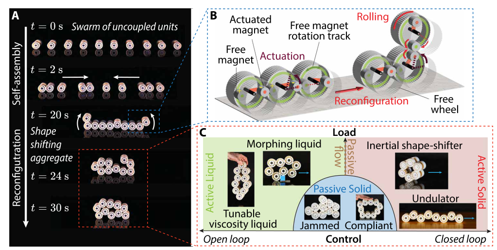
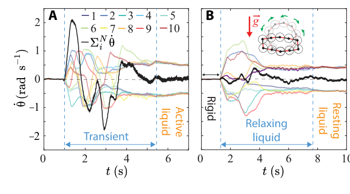

<!-- _class: title -->
<!-- _paginate: false -->
<!-- _header: "" -->

# Granulobot simulation

1. Context and goal

PIR, INSA Lyon, 2026 · Victor and Hugo
Supervisors: Baudouin Saintyves (Inria / INSA, CITI lab), Olivier Simonin

---

<!-- _footer: "Added 2026-11-24 · Saintyves, Spenko, Jaeger, Science Robotics 9, eadh4130 (2024), Fig. 1" -->

## Granulobots

- Gear-like units with **one actuator each**, coupled by magnets: an **active magnet** driven by the motor, a **free magnet** on a pivot.
- Aggregates self-assemble, reconfigure, and show **solid-like and liquid-like** collective states.

---

<!-- _footer: "Added 2026-11-24" -->

## The PIR assignment

- **Two subgroups**: one optimises the robot firmware, the other builds a **software simulator** of the aggregate.
- The simulator should make it easier to **test distributed algorithms** and to **scale to more units** than the hardware allows.
- Both platforms then implement strategies that let an aggregate **find a self-coordinated locomotion state from arbitrary initial parameters**.
- If time allows: compare simulation and hardware.

Sujet 15, PIR Granulobots 2026 (references/Sujet_15_PIR_Granulobots_2026.pdf).

---

<!-- _footer: "Added 2026-11-24" -->

## Our approach

### Simulator
- **PyChrono 10** multibody engine.
- **NSC contacts**: rigid contacts and exact Coulomb friction, solved as constraints.
- Replaces last year's **spring-damper model**: contact stiffness and damping, plus a spring link between neighbours to hold the ring together. Its constants had to be tuned, and stiff ones made the time step unstable.

### Focus
- First the aggregate's **collective states**, starting with the **active liquid state** of a ring of 6 units.
- Then convergence to that state from any start.
- Later, **calibrate** against the real robots.

---

<!-- _footer: "Added 2026-11-24" -->

## Target: the active liquid state

- Closed chain of units, each motor biased with the **same magnitude**.
- Neighbours rotate in **opposite directions**, and the **sum of the rotation speeds stays near zero**.
- Open loop: alternating biases ui = (−1)i |u| (eq. 8).
- Self-organising: ui = |u| sgn(dθi/dt) (eq. 7) reaches it after a transient.

Saintyves et al. (2024), Fig. 4 A–B (N = 10 units).

---

<!-- _footer: "Added 2026-11-24" -->

## Roadmap

| Step | Goal | Status |
| --- | --- | --- |
| **1** | Ring of 6 units, alternating biases (eq. 8): keep the liquid state for 2 to 5 min | in progress holds 60 s; 5 min run running |
| **2** | Reach the synchronised state from random starts (eq. 7), synchronisation metric | next |
| **3** | Compare with the real robots, calibrate magnets, friction, motor | later |

- Cross-cutting: two friction regimes (magnetic contacts roll, steric contacts slip), the paper's dimensions, computing time.

docs/roadmap.md

