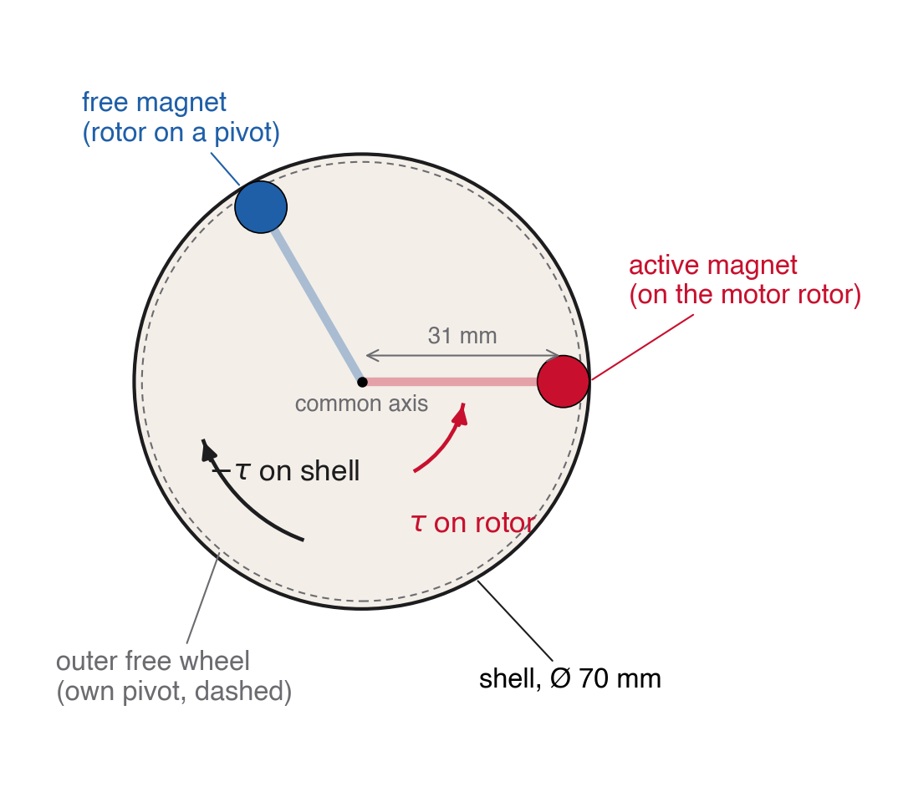
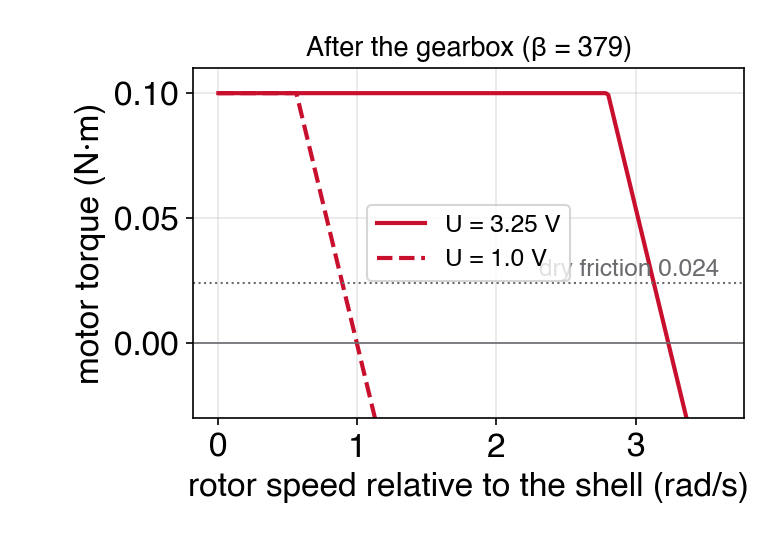
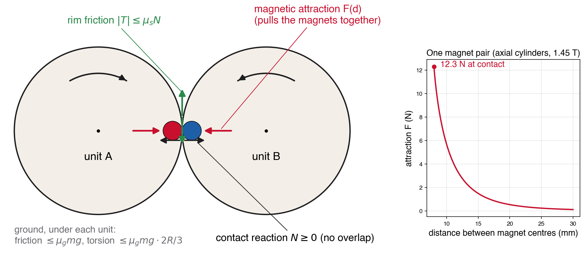
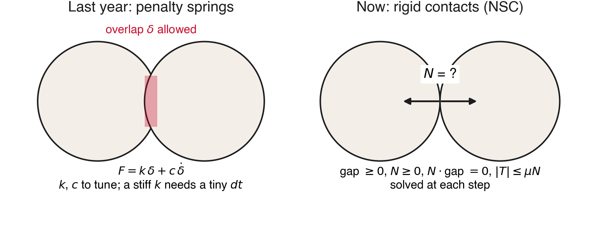
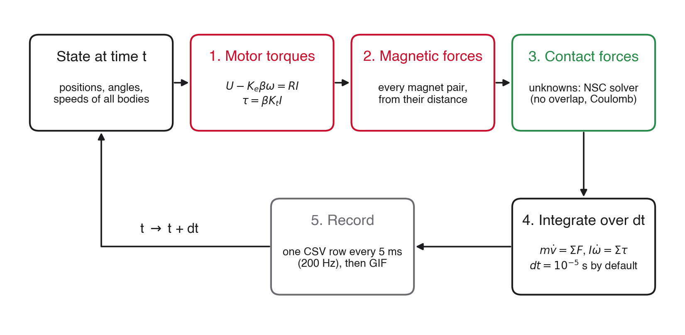

<!-- _class: title -->
<!-- _paginate: false -->
<!-- _header: "" -->

# Granulobot simulation

2. How the simulator works

The physics behind each run: bodies, forces, contacts, time step

---

<!-- _footer: "Added 2026-11-24, revised 2026-11-25 · docs/model.md · src/granulobot/model/unit.py" -->

## One unit: four rigid bodies

- **Shell** 44 g, **active rotor** 36 g, **free rotor** 10 g, **outer free wheel** 8 g: 98 g in all (paper).
- The motor acts **between the active rotor and the shell**: an internal torque τ, with −τ on the shell. Never an external torque.
- The free rotor and the wheel turn on pivots with a small friction.
- Units lie flat; a guide keeps the axes vertical. Motion is **planar**: forces in XY, torques about Z.

---

<!-- _footer: "Added 2026-11-25 · src/granulobot/model/motor.py · paper, fig. 8" -->

## The motor

- DC motor, inductance neglected: **U − Ke β ω = R I**, torque **τ = β Kt I** after the gearbox.
- ω is the rotor speed **relative to the shell**. β = 379, R = 9.6 Ω, Kt, Ke from the paper (fig. 8), not yet our motor.
- At 3.25 V: about 3.2 rad/s with no load (≈ 31 rpm). Torque capped at 0.1 N·m.
- Internal dry friction 0.024 N·m, smoothed (tanh). Voltages ramp up over 0.5 s.

---

<!-- _footer: "Added 2026-11-25 · src/granulobot/model/magnets.py, contacts.py" -->

## What acts between two units, and with the ground

- **Magnets**: finite cylinders, axial poles, 1.45 T (assumed), between **every pair of magnets**.
- **Coulomb friction**: shells μs = 0.6, ground μg = 0.1 (estimates).

---

<!-- _footer: "Added 2026-11-24, revised 2026-11-25 · docs/decisions.md · src/granulobot/model/contacts.py" -->

## Contacts: rigid constraints, not springs

- The contact force is an **unknown**, solved at each step: no overlap, exact Coulomb (stick below μN, slip at μN).
- No stiffness to tune; only a tiny compliance (10⁻⁷ to 10⁻⁸ m/N) to share load between flush contacts.

---

<!-- _footer: "Added 2026-11-25 · src/granulobot/simulation/loop.py · docs/architecture.md" -->

## One time step

- Motor and magnetic forces come **from the current state**; contact forces from the **solver** (PSOR).
- dt = 10⁻⁵ s by default (4 min of computing per simulated second); 10⁻⁴ s for long runs.

---

<!-- _footer: "Added 2026-11-24, revised 2026-11-25 · docs/model.md, \"Parameter origins\" · journal entry 5" -->

## Where the numbers come from

| Parameters | Origin |
| --- | --- |
| R = 35 mm, H = 50 mm, magnets Ø 8 × 10 mm, axial | Hugo's prototype (to measure) |
| Mass 98 g, active rotor, motor constants | Paper, fig. 8 (not our motor yet) |
| 3.25 V target | Estimate: about 30 rpm without load |
| μ shells 0.6, μ ground 0.1, other masses | Estimates, to measure |
| Remanence 1.45 T (N54) | Assumed, to confirm |
| dt, softening, tolerances | Numerical, checked by convergence |

> **Convergence in dt, partly established.** From 10⁻⁴ to 10⁻⁵ s the rotation regime is the same (−0.9 %), but the magnet pairs go from resting in contact to hovering within 0.15 mm (in contact ~1 % of the time), and the slow flattening of the ring speeds up.

---

<!-- _footer: "Added 2026-11-25 · docs/model.md" -->

## What the model leaves out

- **Planar projection**: the units cannot tip; tipping moments are dropped, and the magnets' centres are assumed at the same height.
- **No gear teeth** on the rims: they are smooth cylinders with Coulomb friction.
- **Motor**: no inductance, no gearbox inertia; the internal dry friction is smoothed, so there is no exact static threshold.
- **To calibrate on the robots**: magnet pull-off force, motor speed with and without load, friction between shells and on the table.
