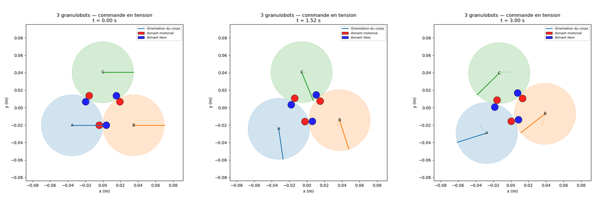
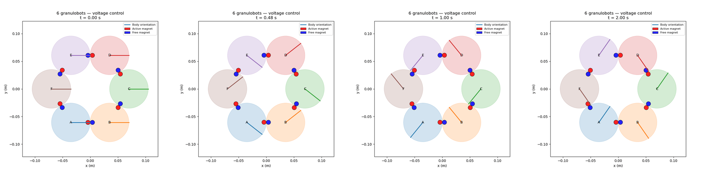
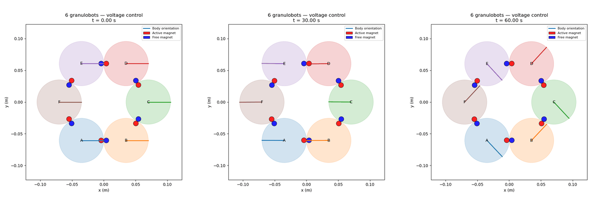

<!-- _class: title -->
<!-- _paginate: false -->
<!-- _header: "" -->

# Granulobot simulation

4. Results

The path from one run to the next, as in `results/journal.md`

---

<!-- _footer: "Added 2026-11-24 · journal entry 1 · results/2026-10-14-triangle-3-units/" -->

## 1. Triangle of 3 units, 3.25 V on every motor

- All three bodies turn **the same way** (−0.38 to −0.45 turn in 3 s) and the centres move by **11.7 to 13.7 mm**. The magnet pairs stay coupled.
- On an odd ring, neighbours cannot turn in opposite directions: the ring is **frustrated**.
- **Decision**: move to an even ring of 6 with alternating biases (eq. 8).

---

<!-- _footer: "Added 2026-11-24 · journal entry 2 · results/2026-11-24-ring6-alternating/" -->

## 2. Ring of 6, alternating ±3.25 V, 2 s

- Bodies turn in alternation, **±0.847 turn**; each active rotor stays locked against its neighbour's free magnet (0.0013 turn in the lab frame).
- Centres move **less than 0.1 mm**; the six magnet pairs stay in contact.
- Same rotation as Hugo's run with his rim friction (−0.848 turn).

---

<!-- _footer: "Added 2026-11-24" -->

## Why the ring stays in place

### Rotors locked, bodies turn
- The magnet pair is a **notch** (about 12 N of attraction): the motor's ~0.045 N·m does not pull the rotor out of it.
- The rotor stays; the motor's **reaction torque turns the shell** instead.

### Rims roll like gears
- Neighbours turn at **equal and opposite** speeds: the rims move together at the contact (0.106 m/s), **no slip**.
- So the friction coefficient plays no part.

### No net force on the centres
- Motor torques are internal; magnetic and contact forces cancel by symmetry.

### The counter-example
- Same voltage on all six (Hugo's run): rims rub in opposite directions, friction pushes the units, which drift by **16 to 42 mm**.
- It ran at dt = 10⁻³ s, so the size of the drift is not reliable.

---

<!-- _footer: "Added 2026-11-24 · journal entry 3 · results/2026-11-24-ring6-alternating/" -->

## 3. Ring of 6, alternating ±3.25 V, 60 s

| Roadmap criterion (step 1) | Over 60 s |
| --- | --- |
| Rotor directions keep alternating | yes, 11 900 of 11 900 samples |
| Sum of rotor speeds near zero | mean 0.0002 rad/s (vs 6 × 2.64) |
| Ring keeps its shape | neighbour distances within 0.1 µm, no detachment |

The ring drifts slowly **as a block**: 0.25 mm in 60 s, cause unknown.

---

<!-- _footer: "Added 2026-11-24" -->

## Open points and next steps

- **Step 1 holds for 60 s at dt = 10⁻⁴ s.** Before calling it validated:
  - a **5 min run** (running now): does the drift stay linear?
  - **convergence in dt**: at 10⁻⁵ s the magnets touch 25 % of the time instead of 100 %;
  - **robustness**: unequal voltages, large perturbations.
- **Then step 2**: reach the state from random starts (eq. 7) and choose a synchronisation metric.
- **Hugo's contact-dependent friction** (μ = 0.05 steric, 1.0 magnetic) is on hold while rims roll; it comes back when contacts slip.

### Questions for the meeting
- Which data can we get for calibration (magnet force, friction, motor)? Do μ = 0.05 and 1.0 match the robots?
