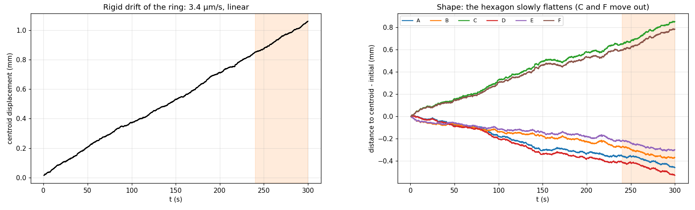
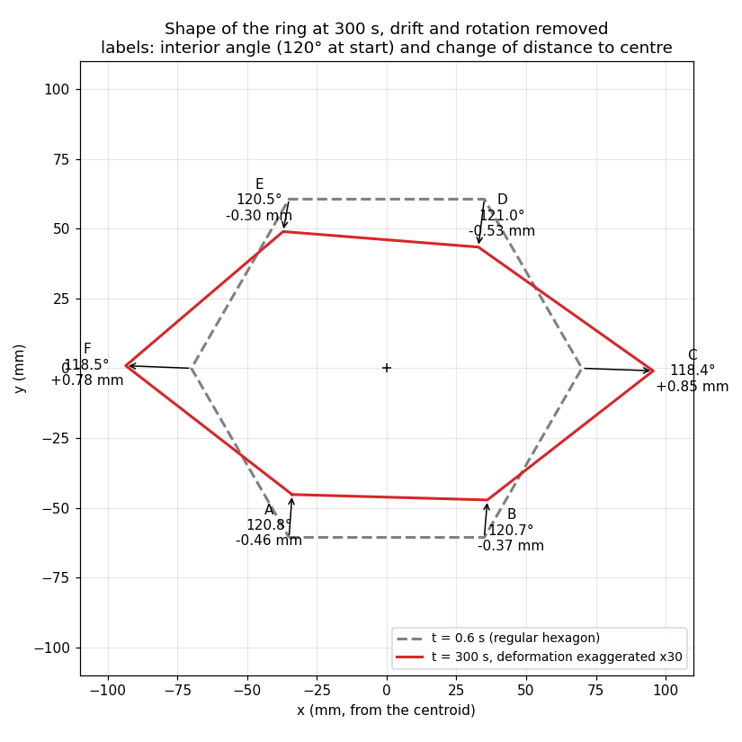
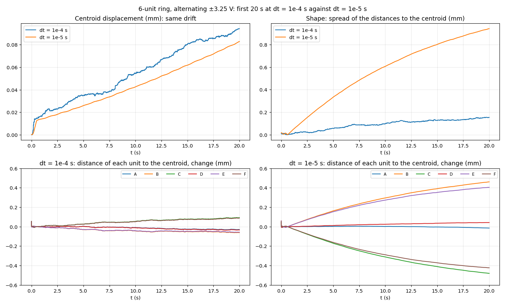

<!-- _class: title -->
<!-- _paginate: false -->
<!-- _header: "" -->

# Granulobot simulation

4. Results

Our reasoning from one run to the next, as in `results/journal.md`

---

<!-- _footer: "Added 2026-11-24 · journal entry 1 · results/2026-10-14-triangle-3-units/" -->

## 1. Triangle of 3 units, 3.25 V on every motor

- All three bodies turn **the same way** (−0.38 to −0.45 turn in 3 s) and the centres move by **11.7 to 13.7 mm**. The magnet pairs stay coupled.
- On an odd ring, neighbours cannot turn in opposite directions: the ring is **frustrated**.
- **Decision**: move to an even ring of 6 with alternating biases (eq. 8), to aim at the liquid state.

---

<!-- _footer: "Added 2026-11-24, revised 2026-11-25 · journal entry 2 · results/2026-11-24-ring6-alternating/" -->

## 2. Ring of 6, alternating ±3.25 V, 2 s

- The liquid state's signature appears at once: bodies turn in alternation, **±0.847 turn**, and the sum of the rotor speeds stays near zero.
- Each active rotor stays **locked** on its neighbour's free magnet (0.0013 turn in the lab frame). The six magnet pairs stay coupled.
- The centres move **less than 0.1 mm**. Why so little?

---

<!-- _footer: "Added 2026-11-24, revised 2026-11-25" -->

## Why the bodies turn and the centres barely move

### Rotors locked, bodies turn
- The magnet pair is a **notch** (about 12 N of attraction): the motor's ~0.045 N·m does not pull the rotor out of it.
- The rotor stays; the motor's **reaction torque turns the shell** instead.

### Rims roll like gears
- Neighbours turn at **equal and opposite** speeds: the rims move together at the contact (about 0.10 m/s), **no slip**.

### Little net force on the centres
- Motor torques are internal; in an ideal hexagon the magnetic and contact forces cancel by symmetry.

### The counter-example
- Same voltage on all six (Hugo's run): rims rub in opposite directions, friction pushes the units, which drift by **16 to 42 mm**.
- It ran at dt = 10⁻³ s, so the size of the drift is not reliable.

---

<!-- _footer: "Added 2026-11-25 · docs/decisions.md, \"Hugo's rim friction model on hold\"" -->

## A side question: Hugo's rim friction, set aside for now

- Hugo's model: friction that depends on the contact. **Steric** contacts (shells touching, no magnets facing) slide, μ = 0.05; **magnetic** contacts grip, μ = 1.0. Values are exploratory, with no source yet.
- In this ring it changes nothing: same rotation with his model and with a uniform μ = 0.6 (**−0.848** against **−0.847** turn at 2 s).
- Why: the rims **roll without slipping**, so μ is never reached, and the only contacts are the six magnetic pairs: **no steric contact** at all.
- **Decision**: keep the uniform friction and set his model aside (planned spec 007). It will matter once contacts slip: random starts, collisions, locomotion.

---

<!-- _footer: "Added 2026-11-24, revised 2026-11-25 · journal entry 3 · results/2026-11-24-ring6-alternating/" -->

## 3. Does it last? Ring of 6, 60 s

| Roadmap criterion (step 1) | Over 60 s |
| --- | --- |
| Rotor directions keep alternating | yes, 11 900 of 11 900 samples |
| Sum of rotor speeds near zero | mean 0.0002 rad/s (vs 6 × 2.64) |
| Ring stays connected | neighbour distances within 0.1 µm, no detachment |

The roadmap asks for 2 to 5 min, and the centroid moves slowly (0.25 mm in 60 s). **Does that drift grow?**

---

<!-- _footer: "Added 2026-11-25 · results/README.md, section Measures" -->

## How we measure the drift and the shape

- **Centroid** C(t): the mean of the six unit centres, recomputed at every sample (200 per second). No unit sits there.
- **Drift**: \|C(t) − C(0)\|, how far the ring moves as a block.
- **Shape**: each unit's distance to the centroid *at the same instant*, minus its value at 0.6 s (after the start ramp). A rigid drift or rotation leaves it unchanged.
- **Interior angles**: the angle at each unit between its two neighbours, 120° in a regular hexagon.
- **Slip at a contact**: tangential speed of one rim against the other at the contact point; only its time average is meaningful.

Full definitions in results/README.md (Measures). Computed for now by plotting scripts outside the repo.

---

<!-- _footer: "Added 2026-11-25 · journal entry 4 · results/2026-11-24-ring6-alternating-300s/" -->

## 4. Ring of 6, 300 s: it holds, but the shape moves

- Step 1 criteria hold for **5 min**: alternation on all 59 900 samples, rotor sum 0.0002 rad/s, no detachment; **±146.2 turns** at a steady 2.967 rad/s.
- The drift stays **linear**: 3.4 µm/s over 300 s (1.06 mm), in a fixed direction.
- A closer look shows the hexagon also **flattens**: C and F move 0.8 mm out. It had already started at 60 s (0.18 mm).

---

<!-- _footer: "Added 2026-11-25 · results/2026-11-24-ring6-alternating-300s/" -->

## Why the hexagon can flatten

- The magnet pairs hold the **sides**: neighbour distances stay within 0.3 µm.
- Nothing holds the **angles**: A and C do not touch, so the angle at B is free.
- 6 points in the plane: 12 coordinates − 3 (move and turn the whole ring) − 6 sides = **3 free shape modes**. A triangle has 0.
- The rims roll on each other, so **rim friction** does not resist. **Ground friction** should, for forces under μN ≈ 0.1 N per unit: why it does not is still open.

Shape at 300 s against the regular hexagon, drift and rigid rotation removed, deformation ×30. Labels: interior angle and change of distance to the centre.

---

<!-- _footer: "Added 2026-11-25 · journal entry 5 · results/2026-11-24-ring6-dt-convergence/" -->

## 5. Is it numerical? Same ring, 20 s at dt = 10⁻⁵ s

| First 20 s | 10⁻⁴ s | 10⁻⁵ s |
| --- | --- | --- |
| Body speed | 2.967 | 2.941 rad/s |
| Alternation | 100 % | 100 % |
| Drift (20 s fit) | 4.2 | 3.7 µm/s |
| Shape spread | 0.15 | 0.94 mm |
| Magnets touching | 100 % | ~1 % |

- **Rotation and drift do not change with dt**: not a time-step artefact (solver tolerance untested).
- Flattening at both steps, 6× faster along B–E at 10⁻⁵ s: real, **not converged**. Magnets hover within 0.15 mm.

---

<!-- _footer: "Added 2026-11-25" -->

## Where we stand

- **Established**: the liquid state of a 6-unit ring with alternating biases holds for **5 min**, and its rotation does not depend on dt.
- **The slow drift and flattening**: < 1 mm and < 2° in 5 min, for units of 70 mm.
  - no effect on alternation, rotor sum or magnet pairs: every step 1 criterion holds;
  - a liquid state has no shape to keep (paper: "ability to move and morph");
  - open: why ground friction does not stop it; robustness (unequal voltages, perturbations);
  - we keep an eye on it: interior angles checked in every run.
- **Tooling**: move the measures and figures from scratch scripts into the code (a spec).

### Our conclusion
- We consider this drift **negligible** and move on to **step 2: random starts** (eq. 7). **Do you agree?**
